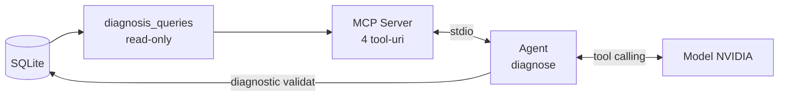
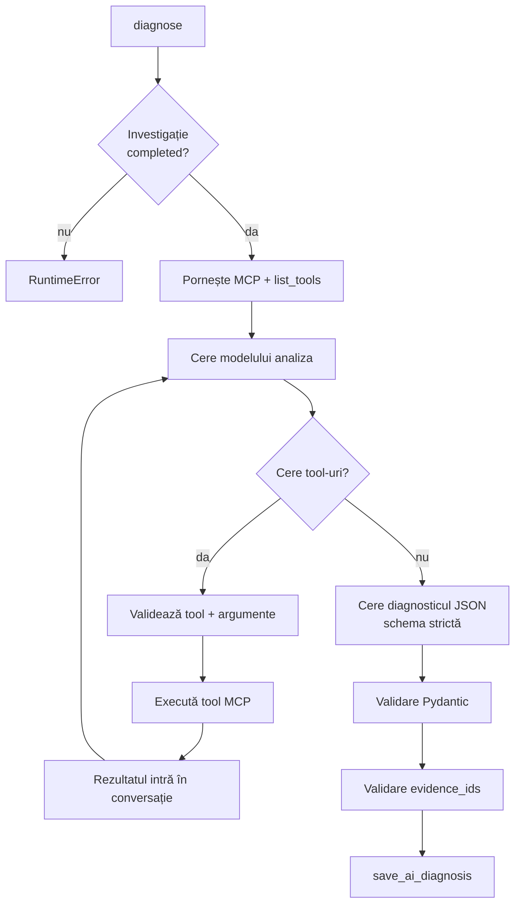

# NetOps Sentinel — M6: AI Diagnosis

Partea care **citește dovezile unei investigații și propune o cauză probabilă și recomandări**, fără să inventeze nimic.

AI-ul nu are acces direct la baza de date. Vede doar ce îi oferă **4 tool-uri MCP**, în mod doar-citire, iar răspunsul lui este verificat înainte să fie salvat.

| Etapă | Ce face | Stare |
|---|---|---|
| **M1–M3** Infrastructura | Monitorizare, alerte pe e-mail, grafice | Funcționează |
| **M4** Incident Manager | Primește alertele și gestionează incidentele | Funcționează |
| **M5** Investigation Engine | Investighează incidentele și salvează dovezile | Funcționează |
| **M6** AI Diagnosis | Propune cauze și recomandări pe baza dovezilor | **Acest document** |



## Cum se leagă de M5

M5 produce **investigații** `completed` cu **dovezi** (`evidences`). M6 pornește exact de aici:

- primește un `investigation_id`;
- acceptă doar investigații cu starea `completed` (cele `running` sau `failed` sunt respinse);
- citește dovezile salvate de Engine și le interpretează;
- salvează rezultatul înapoi în SQLite prin `save_ai_diagnosis` (`database.py`).

**Ideea:** Engine-ul *colectează* fapte, AI-ul le *interpretează*. Cauza nu se ghicește din numele alertei, ci din dovezi.

## Structura

| Fișier | Rol |
|---|---|
| `AI_part/diagnosis_queries.py` | Interogări SQL doar-citire (stratul de date) |
| `AI_part/mcp_server.py` | Expune interogările ca tool-uri MCP (validare + erori clare) |
| `AI_part/diagnosis.py` | Agentul: `diagnose()`, `convert_mcp_tools()`, modelul `AIDiagnosis` |

Lanțul: **SQLite → `diagnosis_queries` → `mcp_server` → agent → model**. Fiecare strat are un singur rol și nu sare peste cel de sub el.

## Stratul de date (`diagnosis_queries.py`)

Toate funcțiile folosesc `get_read_connection`, care deschide SQLite cu `?mode=ro`: **chiar dacă ar apărea o greșeală, AI-ul nu poate modifica baza de date.** Scrierea rămâne exclusiv în `database.py`.

| Funcție | Ce întoarce |
|---|---|
| `get_read_connection` | Conexiune read-only; rândurile devin dicționare (`row_factory`) |
| `get_investigation` | `id`, `incident_id`, `status`, `started_at`, `finished_at`; `None` dacă nu există |
| `get_incident` | `id`, `status`, `severity`, `opened_at`, `closed_at`, `root_cause`; `None` dacă nu există |
| `get_incident_alerts` | Alertele legate de incident (prin `incident_alerts`): `fingerprint`, `alertname`, `router`, `state`, `started_at`, `ended_at` |
| `get_evidences` | Dovezile investigației; coloana `result` (JSON text în DB) este transformată înapoi în obiect |

## Tool-urile MCP (`mcp_server.py`)

Serverul `NetOps Sentinel` rulează ca **proces separat**, pornit de agent prin `stdio`. Fiecare tool verifică datele și aruncă `ToolError` cu mesaj clar, pe care modelul îl poate înțelege.

| Tool | Parametru | Ce face | Erori |
|---|---|---|---|
| `get_investigation` | `investigation_id` | Starea și timpii investigației | ID ≤ 0 · nu există |
| `get_incident` | `incident_id` | Starea, severitatea și cauza (`root_cause`) incidentului | ID ≤ 0 · nu există |
| `get_incident_alerts` | `incident_id` | Alertele care au declanșat incidentul | ID ≤ 0 · incident inexistent |
| `get_evidences` | `investigation_id` | Toate dovezile: `check_type`, `status`, `result`, `collected_at` | ID ≤ 0 · investigație inexistentă |

**De ce există și validarea aici, nu doar în agent:** serverul MCP este o graniță de sine stătătoare. Rămâne sigur și dacă este folosit și de alt client, nu doar de agentul nostru.

Descrierile din docstring (`"""Get an incident by its ID..."""`) sunt **trimise modelului**: așa află ce face fiecare tool și ce câmpuri întoarce.

## Agentul (`diagnosis.py`)

### `convert_mcp_tools`

MCP și API-ul modelului descriu tool-urile în formate diferite. Funcția traduce fiecare tool MCP (`name`, `description`, `input_schema`) în formatul `function` cerut de model. Agentul **descoperă** tool-urile (`list_tools`), nu le scrie de mână, deci un tool nou apare automat.

### `AIDiagnosis` (formatul răspunsului)

| Câmp | Tip | Înseamnă |
|---|---|---|
| `summary` | `str` | Rezumat al faptelor verificate |
| `probable_cause` | `str` | Cauza probabilă sau `insufficient evidence` |
| `confidence` | `low` / `medium` / `high` | Cât de sigur este modelul |
| `evidence_ids` | `list[int]` | ID-urile dovezilor pe care se sprijină |
| `recommendations` | `list[str]` | Pași recomandați (doar nedistructivi) |

`extra="forbid"` respinge orice câmp în plus. Același model este folosit și pentru schema trimisă modelului, și pentru validarea răspunsului, deci cele două nu pot diverge.

### `diagnose(investigation_id)` — pe etape



1. **Verificare:** investigația există și este `completed`. Altfel se oprește imediat.
2. **Conectare:** pornește serverul MCP și convertește tool-urile.
3. **Bucla agentului:** modelul decide ce tool-uri are nevoie (de obicei: investigația, incidentul, alertele, dovezile). Rezultatele se adaugă în conversație, iar bucla continuă.
4. **Răspuns final:** când nu mai cere tool-uri, agentul face **un al doilea apel**, cu un prompt de sistem strict și `json_schema` cu `strict: True`, ca să obțină exact formatul `AIDiagnosis`.
5. **Validare și salvare:** JSON-ul este validat, ID-urile dovezilor sunt verificate, apoi diagnosticul este salvat.

**De ce două apeluri:** primul lasă modelul să *exploreze* liber cu tool-uri, al doilea îl obligă să *formuleze* un răspuns strict. Amestecate, modelul tinde să încalce fie formatul, fie logica.

### Mecanismele de siguranță

| Protecție | Unde | Ce previne |
|---|---|---|
| Conexiune `mode=ro` | `diagnosis_queries` | Modificarea bazei de date de către AI |
| Listă de tool-uri permise | `diagnose` | Apelarea altor tool-uri decât cele 4 |
| Argumente identice cu cele așteptate | `diagnose` | Citirea altor investigații sau incidente decât cea analizată |
| Maxim 4 tool-uri într-un răspuns | `diagnose` | Cereri în avalanșă |
| Maxim 8 runde | `diagnose` | Buclă infinită și cost necontrolat |
| Trebuie să fi rulat cel puțin un tool | `diagnose` | Răspuns din „imaginație", fără dovezi |
| Dovezile trebuie să aparțină investigației | `diagnose` | Date amestecate de la alte investigații |
| `evidence_ids` ⊆ ID-urile returnate | `diagnose` | Referințe la dovezi inventate |
| Prompt: „`insufficient evidence`", recomandări neditructive | prompt de sistem | Cauze inventate și recomandări periculoase |
| Cheia API din variabila `NVIDIA_API_KEY` | modul | Cheie scrisă în cod |

Dacă oricare verificare eșuează, `diagnose` aruncă `RuntimeError` și **nu salvează nimic**. Un diagnostic fie este complet verificat, fie nu există.

## Exemplu de rulare

```text
Executed: get_investigation {'investigation_id': 7}
Executed: get_incident {'incident_id': 3}
Executed: get_incident_alerts {'incident_id': 3}
Executed: get_evidences {'investigation_id': 7}
Evidence count sent to AI: 6
AI diagnosis saved for investigation 7
```

## Configurare

| Setare | Valoare |
|---|---|
| Endpoint | `https://integrate.api.nvidia.com/v1` (compatibil OpenAI) |
| Model | `nvidia/nemotron-3.5-super-vl-120b-a12b` |
| Cheie | variabila de mediu `NVIDIA_API_KEY` |
| Server MCP | pornit automat: `python -m incident_manager.AI_part.mcp_server` |

## Ce urmează

1. Endpoint API pentru diagnostic: `POST /investigations/{id}/diagnosis` și citirea lui.
2. Teste: agent cu model simulat (mock) și verificarea fiecărei protecții din tabel.
3. Afișarea diagnosticului în e-mail sau în Grafana.
