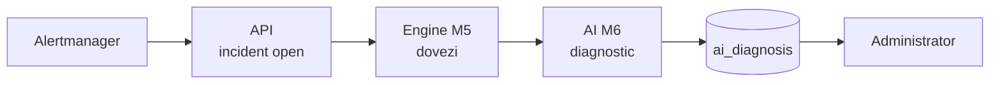
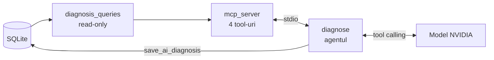

# NetOps Sentinel — M6: AI Diagnosis

Până aici, sistemul știe **că** s-a întâmplat ceva (M1–M4) și a strâns **dovezile** (M5). M6 este partea care citește dovezile și spune pe înțelesul tuturor ce s-a întâmplat probabil și ce ar merita verificat.

## Ce face AI-ul în proiect (și ce nu)

AI-ul este un **analist**, nu un administrator.

| Face | Nu face |
|---|---|
| Citește incidentul, alertele și dovezile unei investigații | Nu modifică incidente și nu le schimbă starea |
| Scrie un rezumat, o cauză probabilă și recomandări | Nu completează `root_cause` și nu rulează nimic pe VM-uri |
| Își salvează răspunsul în `investigations.ai_diagnosis` | Nu are acces direct la baza de date |

Decizia rămâne la administrator: AI-ul doar îi pune în față o părere argumentată cu dovezi.

## Unde se leagă



- **Pornire:** `POST /incidents/{id}/investigations` rulează Engine-ul, răspunde cu `201`, iar apoi pornește `diagnose` **în fundal** (`BackgroundTasks`). Clientul nu așteaptă modelul.
- **Citire:** `GET /investigations/{id}/diagnosis`. Până când diagnosticul e gata, răspunsul este `404 „AI diagnosis not available yet"`.
- **Condiție:** se lucrează doar cu investigații `completed`.
Engine-ul adună faptele, AI-ul le interpretează. Cauza nu se ghicește din numele alertei, ci din ce au găsit collectorii.

## Cum e construit

Trei straturi, fiecare cu un singur rol. AI-ul vede doar ultimul.



### 1. `diagnosis_queries.py` — citirea

Interogări SQL doar pentru citit. Conexiunea se deschide cu `mode=ro`, deci chiar și o greșeală nu poate modifica baza. Câmpurile JSON (`result`) sunt transformate înapoi în obiecte.

### 2. `mcp_server.py` — tool-urile

Serverul MCP rulează ca proces separat, pornit de agent. Expune exact patru tool-uri:

| Tool | Întoarce |
|---|---|
| `get_investigation` | Starea și timpii investigației |
| `get_incident` | Starea, severitatea și cauza incidentului |
| `get_incident_alerts` | Alertele care au declanșat incidentul |
| `get_evidences` | Dovezile: tip, status, rezultat, moment |

Fiecare verifică ID-ul (pozitiv, existent) și aruncă o eroare clară dacă nu e bun. Descrierile din docstring ajung la model, așa află ce poate face fiecare tool.

### 3. `diagnosis.py` — agentul

`diagnose(investigation_id)` conduce totul:

1. Verifică dacă investigația există și e `completed`.
2. Pornește serverul MCP și descoperă tool-urile (`convert_mcp_tools` le traduce în formatul modelului).
3. Modelul cere tool-uri, agentul le validează și le execută, iar rezultatele se întorc în conversație. Se repetă până modelul are destule date.
4. Un al doilea apel cere răspunsul final în format strict (`AIDiagnosis`).
5. Se validează răspunsul și se salvează.
**De ce două apeluri:** în primul, modelul explorează liber cu tool-uri. În al doilea, e obligat să dea un răspuns de forma exactă pe care o așteptăm. Amestecate, tind să se strice reciproc.

## Ce produce

| Câmp | Înseamnă |
|---|---|
| `summary` | Rezumat al faptelor verificate |
| `probable_cause` | Cauza probabilă, sau `insufficient evidence` dacă nu se poate spune |
| `confidence` | `low`, `medium` sau `high` |
| `evidence_ids` | Dovezile pe care se sprijină |
| `recommendations` | Pași recomandați, doar nedistructivi |

Exemplu pentru un router căzut:

```json
{
  "summary": "R1 nu răspunde la Prometheus; metricile nu au fost colectate.",
  "probable_cause": "Serviciul node_exporter sau mașina R1 este oprită.",
  "confidence": "medium",
  "evidence_ids": [12],
  "recommendations": ["Verifică dacă VM-ul R1 pornește", "Verifică starea serviciului node_exporter"]
}
```

## De ce poți avea încredere în el

Modelul nu e lăsat să facă ce vrea. Fiecare pas e verificat de cod:

| Protecție | Ce previne |
|---|---|
| Baza de date se citește cu `mode=ro` | Modificări făcute de AI |
| Doar cele 4 tool-uri sunt permise | Apelarea altor funcții |
| Argumentele trebuie să fie exact investigația și incidentul analizate | Citirea datelor altor incidente |
| Maxim 4 tool-uri pe răspuns și 8 runde | Bucle fără sfârșit și costuri necontrolate |
| Trebuie să fi rulat cel puțin un tool | Răspunsuri „din imaginație" |
| Dovezile trebuie să aparțină investigației | Date amestecate |
| `evidence_ids` trebuie să existe între dovezile primite | Dovezi inventate |
| Prompt: „fără invenții, `insufficient evidence` dacă nu știi, recomandări nedistructive" | Cauze inventate și sfaturi periculoase |

Dacă o verificare eșuează, `diagnose` se oprește cu eroare și **nu salvează nimic**. Un diagnostic fie e complet verificat, fie nu există.

## Configurare

| Setare | Valoare |
|---|---|
| Endpoint | `https://integrate.api.nvidia.com/v1` (compatibil OpenAI) |
| Model | `nvidia/nemotron-3.5-super-vl-120b-a12b` |
| Cheie | variabila de mediu `NVIDIA_API_KEY`, necesară la pornirea aplicației |
| Server MCP | pornit automat de agent: `python -m incident_manager.AI_part.mcp_server` |

