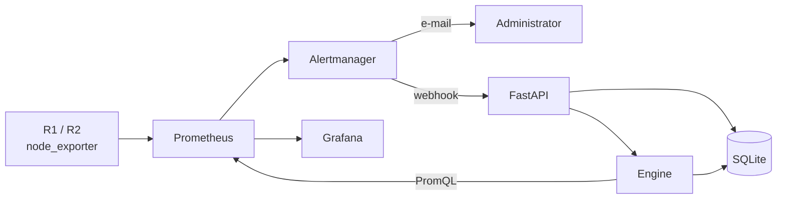

# NetOps Sentinel

Sistem care **supraveghează două VM-uri (R1 și R2), anunță când ceva nu merge și începe singur să afle de ce**.

Când apare o problemă (VM căzut, CPU/RAM/disc aproape pline), administratorul primește e-mail, iar problema este salvată ca **incident** și urmărită până la închidere. Pentru fiecare incident se poate porni o **investigație automată** care colectează dovezi.

| Etapă | Ce face | Stare |
|---|---|---|
| **M1–M3** Infrastructura | Monitorizare, alerte pe e-mail, grafice | Funcționează |
| **M4** Incident Manager | Primește alertele și gestionează incidentele | Funcționează |
| **M5** Investigation Engine | Investighează incidentele și salvează dovezile | În dezvoltare |
| **M6** AI | Propune cauze și recomandări pe baza dovezilor | Planificat |



## M1–M3: Infrastructura

- **node_exporter** (pe R1 și R2) expune starea mașinii: CPU, RAM, disc.
- **Prometheus** citește datele la 15 secunde și verifică regulile: țintă căzută (2 min), CPU > 90% (5 min), RAM > 85% (5 min), disc > 85% (10 min).
- **Alertmanager** trimite alerta pe **e-mail** și către **API** (webhook), iar la final trimite și „rezolvat".
- **Grafana** afișează grafice; nu face parte din fluxul alertelor.
- Prometheus, Alertmanager și Grafana rulează în **Docker Compose**; API-ul rulează pe host (port 8000).

## M4: Incident Manager

**Ideea:** sistemul află că există o problemă și o înregistrează corect, o singură dată.

**Cum merge:** Alertmanager trimite alerta → API-ul o verifică → o salvează **într-o singură tranzacție** (ori se salvează tot, ori nimic) → dacă e nouă, creează un incident `open`. Aceeași alertă trimisă de mai multe ori nu creează incidente multiple (**deduplicare** după `fingerprint` + `started_at`).

Incidentul trece strict prin **`open → investigating → resolved → closed`**; nu se poate sări peste pași. O alertă „rezolvată" nu închide singură incidentul.

### API (`main.py`)

| Funcție / rută | Ce face |
|---|---|
| `receive_alerts`<br>`POST /webhook/alerts` | Primește alertele de la Alertmanager, le validează (alertele invalide sunt sărite, nu opresc restul) și le trimite la salvare. Întoarce câte au fost create, actualizate, duplicate sau sărite. |
| `read_incident`<br>`GET /incidents/{id}` | Returnează un incident; **404** dacă nu există. |
| `update_status`<br>`PATCH /incidents/{id}/status` | Cere trecerea la starea următoare. **404** = nu există, **409** = tranziție invalidă, **422** = date greșite. |
| `create_investigation_incident`<br>`POST /incidents/{id}/investigations` | Creează o investigație `running` (**201**); **404** dacă incidentul lipsește. |

### Baza de date (`database.py`)

| Funcție | Ce face |
|---|---|
| `get_db_connection` | Deschide SQLite și activează verificarea relațiilor dintre tabele (`foreign_keys`). |
| `save_alert` | Compară alerta cu cele existente: **nouă** → o inserează, **schimbată** → o actualizează, **identică** → nu face nimic. |
| `create_incident_for_alert` | Creează incidentul `open` și îl leagă de alertă. |
| `process_alert` | Coordonează `save_alert` și `create_incident_for_alert` într-o **singură tranzacție**: `commit` la succes, `rollback` la eroare. |
| `update_incident_status` | Verifică dacă tranziția e permisă, actualizează starea și notează ora la `closed`. |
| `get_incident` / `get_incidents` | Citesc un incident sau pe toate. |

> **Regula de bază:** funcțiile mici (`save_alert`, `create_incident_for_alert`) nu salvează singure. Funcția care deschide conexiunea (`process_alert`) decide când se face `commit`, ca totul să reușească sau să se anuleze împreună.

## M5: Investigation Engine

**Ideea:** în loc să ghicim cauza din numele alertei, **întrebăm Prometheus** și păstrăm răspunsul ca dovadă.

Exemplu: incident `NodeExporterDown` pe R1 → engine-ul află că e R1 → întreabă Prometheus dacă R1 răspunde → salvează rezultatul.

### Funcțiile, în ordinea în care rulează

| # | Funcție | Fișier | Ce face |
|---|---|---|---|
| 1 | `get_incident_router` | `database.py` | Găsește routerul afectat (R1, R2 sau nimic) prin legătura incident → alertă. |
| 2 | `create_investigation` | `database.py` | Verifică dacă incidentul există și creează investigația cu starea `running`. |
| 3 | `query_prometheus` | `collectors/prometheus.py` | Trimite o interogare PromQL către Prometheus prin HTTP (cu timeout de 5 secunde) și întoarce rezultatele. |
| 4 | `collect_node_status` | `collectors/prometheus.py` | Folosește `query_prometheus` pe `up{router="R1"}` și transformă răspunsul într-o dovadă (tabelul de mai jos). |
| 5 | `save_evidence` | `database.py` | Salvează dovada în baza de date; rezultatul e transformat în JSON text. |
| 6 | `finish_investigation` | `database.py` | Trece investigația din `running` în `completed` sau `failed` și notează ora. |
| | `run_investigation` | `engine.py` | **Orchestratorul:** apelează funcțiile 1–6 în ordine. Dacă ceva eșuează, investigația e marcată `failed`, nu rămâne blocată. |

| Rezultat `up` | Înseamnă | Stare dovadă |
|---|---|---|
| `1` | Prometheus poate colecta date de la țintă | `success` |
| `0` | Prometheus nu poate colecta date | `failed` |
| fără date | Nu există nicio serie pentru interogare | `error` |

`up = 1` nu înseamnă că toată rețeaua e în regulă, ci doar că ținta poate fi interogată.

## Baza de date (SQLite)

`alerts` · `incidents` · `incident_alerts` (legătura dintre ele) · `investigations` (M5) · `evidences` (M5)

## Pornire

```bash
cd monitoring && docker compose up -d
cd ../incident_manager
python3 -m venv .venv && source .venv/bin/activate
pip install "fastapi[standard]" requests
uvicorn main:app --reload --host 0.0.0.0 --port 8000
```

Docs interactive: `http://127.0.0.1:8000/docs`. Baza `data/incidents.db` trebuie să aibă deja tabelele.

## Ce urmează

1. Conectăm `POST /incidents/{id}/investigations` la `run_investigation()` (acum creează doar înregistrarea) și testăm tot fluxul cap-coadă.
2. Adăugăm verificări noi în Collector: rețea și sistem (CPU, RAM, disc).
3. **M6:** AI-ul folosește dovezile pentru ipoteze și recomandări.
4. Curățenie: creare automată a bazei de date, lista de incidente și dovezi prin API, teste, `requirements.txt`, autentificare.