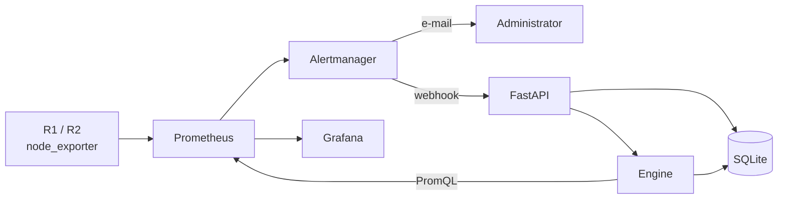
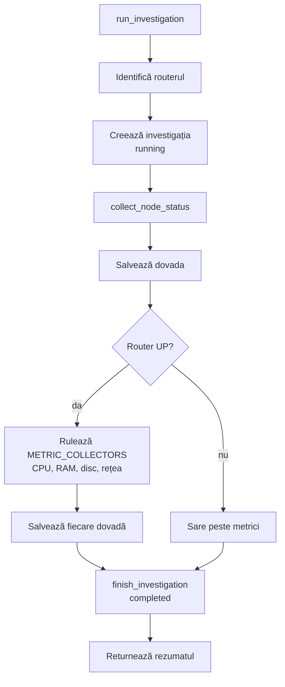

# NetOps Sentinel

Sistem care **supraveghează două VM-uri (R1 și R2), anunță când ceva nu merge și află singur de ce**.

Când apare o problemă (VM căzut, CPU/RAM/disc aproape pline), administratorul primește e-mail, iar problema este salvată ca **incident** și urmărită până la închidere. Pentru fiecare incident se poate porni o **investigație automată** care colectează dovezi de la Prometheus.

| Etapă | Ce face | Stare |
|---|---|---|
| **M1–M3** Infrastructura | Monitorizare, alerte pe e-mail, grafice | Funcționează |
| **M4** Incident Manager | Primește alertele și gestionează incidentele | Funcționează |
| **M5** Investigation Engine | Investighează incidentele și salvează dovezile | Funcționează |
| **M6** AI | Propune cauze și recomandări pe baza dovezilor | Planificat |

## M1–M3: Infrastructura

- **node_exporter** (pe R1 și R2) expune starea mașinii: CPU, RAM, disc, rețea.
- **Prometheus** citește datele la 15 secunde și verifică regulile: țintă căzută (2 min), CPU > 90% (5 min), RAM > 85% (5 min), disc > 85% (10 min).
- **Alertmanager** trimite alerta pe **e-mail** și către **API** (webhook), iar la final trimite și „rezolvat".
- **Grafana** afișează grafice; nu face parte din fluxul alertelor.
- Prometheus, Alertmanager și Grafana rulează în **Docker Compose**; API-ul rulează pe host (port 8000).

## M4: Incident Manager

**Ideea:** sistemul află că există o problemă și o înregistrează corect, o singură dată.

**Cum merge:** Alertmanager trimite alerta → API-ul o verifică → o salvează **într-o singură tranzacție** (ori se salvează tot, ori nimic) → dacă e nouă, creează un incident `open`. Aceeași alertă trimisă de mai multe ori nu creează incidente multiple (**deduplicare** după `fingerprint` + `started_at`).

Incidentul trece strict prin **`open → investigating → resolved → closed`**; nu se poate sări peste pași. O alertă „rezolvată" nu închide singură incidentul.

### API (`main.py`)

| Funcție / rută | Ce face |
|---|---|
| `receive_alerts` `POST /webhook/alerts` | Primește alertele de la Alertmanager, le validează (alertele invalide sunt sărite, nu opresc restul) și le trimite la salvare. Întoarce câte au fost create, actualizate, duplicate sau sărite. |
| `read_incident` `GET /incidents/{id}` | Returnează un incident; **404** dacă nu există. |
| `update_status` `PATCH /incidents/{id}/status` | Cere trecerea la starea următoare. **404** = nu există, **409** = tranziție invalidă, **422** = date greșite. |
| `create_investigation_incident` `POST /incidents/{id}/investigations` | Pornește `run_investigation()` pentru incident și returnează rezumatul (**201**); **404** dacă incidentul lipsește. |

### Baza de date (`database.py`)

| Funcție | Ce face |
|---|---|
| `get_db_connection` | Deschide SQLite și activează verificarea relațiilor dintre tabele (`foreign_keys`). |
| `save_alert` | Compară alerta cu cele existente: **nouă** → o inserează, **schimbată** → o actualizează, **identică** → nu face nimic. |
| `create_incident_for_alert` | Creează incidentul `open` și îl leagă de alertă. |
| `process_alert` | Coordonează `save_alert` și `create_incident_for_alert` într-o **singură tranzacție**: `commit` la succes, `rollback` la eroare. |
| `update_incident_status` | Verifică dacă tranziția e permisă, actualizează starea și notează ora la `closed`. |
| `get_incident` / `get_incidents` | Citesc un incident sau pe toate. |

> **Regula de bază:** funcțiile mici (`save_alert`, `create_incident_for_alert`) nu salvează singure. Funcția care deschide conexiunea (`process_alert`) decide când se face `commit`, ca totul să reușească sau să se anuleze împreună.

## M5: Investigation Engine

**Ideea:** în loc să ghicim cauza din numele alertei, **întrebăm Prometheus** și păstrăm răspunsul ca dovadă.

**Cum merge:** Engine-ul decide *ce* se verifică, iar Collectorii doar *colectează* date. Prima verificare e mereu disponibilitatea routerului; restul rulează numai dacă routerul răspunde.

Dacă routerul e **DOWN**, investigația tot se încheie `completed`: Engine-ul și-a făcut treaba, iar dovada `prometheus_up` arată eșecul (`failed`). Dacă apare o excepție, investigația e marcată `failed`, nu rămâne blocată în `running`.

### Funcțiile, în ordinea în care rulează

| # | Funcție | Fișier | Ce face |
|---|---|---|---|
| 1 | `get_incident_router` | `database.py` | Găsește routerul afectat (R1, R2 sau nimic) prin legătura incident → alertă. |
| 2 | `create_investigation` | `database.py` | Verifică dacă incidentul există și creează investigația cu starea `running`. |
| 3 | `collect_node_status` | `collectors/prometheus.py` | Verifică dacă routerul răspunde (`up{router="R1"}`). Rulează **primul**, mereu. |
| 4 | `METRIC_COLLECTORS` | `engine.py` | Lista collectorilor de metrici, executați doar dacă routerul e UP. |
| 5 | `save_evidence` | `database.py` | Salvează fiecare dovadă; rezultatul e transformat în JSON text. |
| 6 | `finish_investigation` | `database.py` | Trece investigația din `running` în `completed` sau `failed` și notează ora. |
| | `run_investigation` | `engine.py` | **Orchestratorul:** apelează pașii 1–6 în ordine și returnează rezumatul. |

Toate interogările trec prin `query_prometheus` (HTTP către Prometheus, timeout 5 secunde).

### Collectorii (`collectors/prometheus.py`)

Fiecare întoarce aceeași formă: `check_type`, `status`, `result`. Collectorii **nu** verifică dacă routerul e UP, pentru că Engine-ul îi apelează doar când este.

| Collector | Ce măsoară | Statusuri posibile |
|---|---|---|
| `collect_node_status` | Routerul răspunde la Prometheus (`up`) | `success` / `failed` / `error` |
| `collect_cpu_usage` | Folosirea CPU | `success` / `warning` / `error` |
| `collect_memory_usage` | Folosirea RAM | `success` / `warning` / `error` |
| `collect_disk_usage` | Spațiul ocupat pe disc | `success` / `warning` / `error` |
| `collect_network_interfaces` | Interfețele de rețea (sus/jos) | `success` / `warning` / `error` |
| `collect_network_errors` | Erori RX/TX pe secundă, pe interfață, în ultimele 5 minute (fără `lo`) | `success` / `warning` / `error` |

**Statusul unei dovezi:**

| Status | Înseamnă |
|---|---|
| `success` | Totul în regulă |
| `warning` | Datele există, dar o valoare e peste prag (de exemplu o interfață cu erori sau căzută) |
| `failed` | Ținta nu poate fi colectată (`up = 0`) |
| `error` | Prometheus nu a returnat date pentru interogare |

`up = 1` nu înseamnă că toată rețeaua e în regulă, ci doar că ținta poate fi interogată. De asta urmează verificările de metrici.

### Rezultat

| Situație | Dovezi salvate | Status investigație |
|---|---|---|
| Router UP | toate (node status + metrici) | `completed` |
| Router DOWN | 1 (`prometheus_up`, `failed`) | `completed` |
| Eroare în timpul rulării | cele salvate până atunci | `failed` |

## Baza de date (SQLite)

`alerts` · `incidents` · `incident_alerts` (legătura dintre ele) · `investigations` (M5) · `evidences` (M5)

## Ce urmează

1. **M6:** AI-ul folosește dovezile pentru ipoteze de cauză și recomandări.
2. Curățenie: creare automată a bazei de date, lista de incidente și dovezi prin API, teste, `requirements.txt`, autentificare.