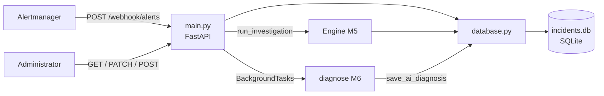
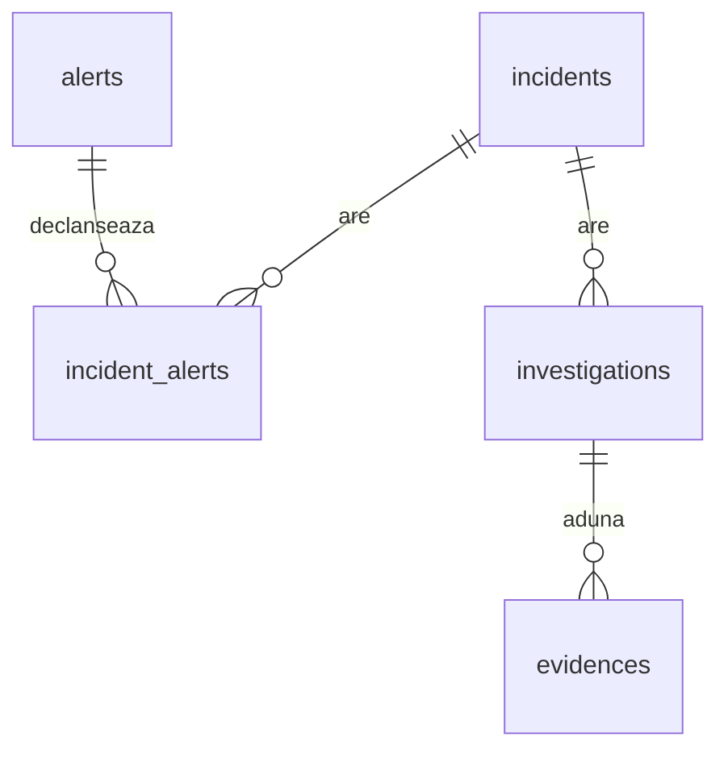

README database api · MD
# NetOps Sentinel — Baza de date și API-ul

Trei fișiere țin proiectul în picioare. `data.sql` spune **cum arată datele**, `database.py` **cum se citesc și se scriu**, iar `main.py` **cum ajung cererile din exterior până la ele**. Tot ce vine după (Engine-ul M5, AI-ul M6) se sprijină pe ele.

Regula după care sunt împărțite: **SQL doar în `database.py`, HTTP doar în `main.py`.** `main.py` nu deschide conexiuni, iar `database.py` nu știe nimic despre JSON-ul de la Alertmanager sau despre coduri HTTP.

---

## `data.sql` — datele

Cinci tabele, legate între ele:

| Tabel | Ce ține |
|---|---|
| `incidents` | Problema: `status`, `severity`, `opened_at`, `closed_at`, `root_cause` |
| `alerts` | Un episod de alertă: `fingerprint`, `alertname`, `router`, `state`, `started_at`, `ended_at` |
| `incident_alerts` | Legătura many-to-many: un incident poate avea mai multe alerte și invers |
| `investigations` | O rulare a Engine-ului pe un incident, plus `ai_diagnosis` (gol până îl scrie M6) |
| `evidences` | Dovezile unei investigații: `check_type`, `status`, `result` (JSON ca text) |

Baza se apără singură: `CHECK` pe fiecare câmp de stare (`incidents`, `alerts`, `investigations`, `evidences`), `NOT NULL` pe câmpurile esențiale și chei străine peste tot. Chiar dacă o greșeală scapă din cod, o valoare inventată nu intră.

Fișierul are două părți: schema (`CREATE TABLE`, plus `ALTER TABLE` pentru `ai_diagnosis`, adăugat când a apărut M6) și un jurnal cu comenzile încercate de mână (`INSERT`, `JOIN`, `UPDATE`). A doua parte e un caiet de probe, nu un script: dacă îl rulezi încă o dată, dublezi datele de test.

---

## `database.py` — accesul la date

Fiecare funcție care scrie are același ritm: conexiune nouă, operațiile, `commit`, iar dacă pică ceva `rollback` și eroarea e rearuncată ca FastAPI să o vadă. La final conexiunea se închide mereu. `PRAGMA foreign_keys = ON` rulează la fiecare conexiune, pentru că SQLite ignoră altfel cheile străine. Valorile intră prin `?`, niciodată lipite în SQL.

| Zonă | Funcții |
|---|---|
| Citire | `get_incidents`, `get_incident` (întoarce `None` dacă nu există) |
| Alerte | `save_alert`, `create_incident_for_alert`, `process_alert` |
| Stări | `update_incident_status` |
| Investigații | `create_investigation`, `finish_investigation`, `get_incident_router` |
| Dovezi | `save_evidence` (dicționarul devine text JSON) |
| AI | `save_ai_diagnosis`, `get_saved_ai_diagnosis` |

### Alertele

O alertă e identificată prin `(fingerprint, started_at)`. `save_alert` verifică ce există deja și alege:

- nu există → `INSERT`, rezultat `created`
- există, dar `state` sau `ended_at` s-au schimbat (de ex. `firing` → `resolved`) → `UPDATE`, rezultat `updated`
- există și nimic nu s-a schimbat → nu scrie nimic, rezultat `duplicate`
`process_alert` coordonatorul: salvează alerta și deschide un incident **doar** dacă alerta e nouă și `firing`. Repetările și rezolvările nu fac incidente în plus. Alerta, incidentul și legătura dintre ele se salvează sub același `commit`: ori toate, ori niciuna.

### Starea incidentului

Merge doar înainte, câte un pas, fără sărituri și fără întoarceri:

`open → investigating → resolved → closed`

La `closed` se completează și `closed_at`, în UTC (`2026-11-07T20:00:00Z`). Update-ul are `AND status = ?`, deci schimbă rândul doar dacă nimeni nu l-a modificat între timp. Dacă s-a întâmplat asta, primești `status_changed`. Același truc îl folosește `finish_investigation` (`AND status = 'running'`), care acceptă doar `completed` sau `failed`.

### Cum raportează erorile

Funcțiile de flux (`update_incident_status`, `finish_investigation`) întorc `{"success": False, "error": "..."}`. Cele de citire întorc `None`. `save_ai_diagnosis` aruncă excepții, pentru că un diagnostic nesalvat trebuie să oprească agentul, iar salvarea se face doar pentru o investigație `completed`.

---

## `main.py` — API-ul

| Endpoint | Rol | Răspunsuri |
|---|---|---|
| `POST /webhook/alerts` | Primește alertele de la Alertmanager | `200`, `400` dacă `alerts` nu e listă |
| `GET /incidents/{id}` | Citește un incident | `200`, `404` |
| `PATCH /incidents/{id}/status` | Mută incidentul la pasul următor | `200`, `404`, `409`, `422` |
| `POST /incidents/{id}/investigations` | Pornește investigația și, în fundal, diagnosticul AI | `201`, `404`, `422` |
| `GET /investigations/{id}/diagnosis` | Citește diagnosticul | `200`, `404` |

### Webhook-ul

Alertmanager trimite alertele grupate, iar `main.py` nu are încredere oarbă în ele. Pentru fiecare:

1. Sare peste ce nu e obiect JSON sau nu are `labels` și numără în `skipped`.
2. Extrage câmpurile cu `.get()`, deci o cheie lipsă nu strică nimic.
3. Transformă `endsAt` din `0001-01-01...` (alertă încă activă) în `None`.
4. Sare peste alertele fără `fingerprint`, `alertname`, `startsAt` sau cu stare în afara `firing` / `resolved`.
5. Află routerul: eticheta `router`, apoi dicționarul `ROUTERS` după `instance`, altfel `unknown`.
6. Predă alerta lui `process_alert`.
Răspunsul spune ce s-a întâmplat: `received`, numerele `created` / `updated` / `duplicate` / `skipped` și lista alertelor, fiecare cu `action`, `alert_id` și `incident_id` (`null` când nu s-a deschis niciun incident).

### Erorile

`database.py` întoarce coduri textuale, `main.py` le face coduri HTTP:

| Din `database.py` | HTTP | Înseamnă |
|---|---|---|
| `incident_not_found` | `404` | Nu există |
| `invalid_transition` | `409` | Nu respectă fluxul de stări |
| `status_changed` | `409` | Altcineva a schimbat starea între timp |
| altceva | `400` | Cerere invalidă |

Corpul `{"status": "investigating"}` e verificat de Pydantic (`IncidentStatusUpdate`); dacă forma e greșită, FastAPI răspunde singur `422`.

### De ce diagnosticul rulează în fundal

Modelul AI poate dura. De aceea `POST .../investigations` rulează Engine-ul, răspunde imediat `201` și pornește `diagnose` prin `BackgroundTasks`. Până e gata, `GET .../diagnosis` răspunde `404 „AI diagnosis not available yet"`.

---

## De știut

- `closed_at` are două formate: `datetime('now')` din `data.sql` dă `2026-11-07 20:00:00`, iar Python scrie `2026-11-07T20:00:00Z`.
- `alerts` nu are `UNIQUE (fingerprint, started_at)`, deci duplicatele sunt oprite doar de cod; două cereri simultane ar putea insera același episod.
- `get_incident_router` folosește `fetchone()`: dacă un incident are mai multe alerte, primești doar primul router.
- `read_incident` citește coloanele după poziție (`incident[0]`...); dacă se schimbă ordinea, răspunsul se strică fără eroare.
- Linia `####...` din `data.sql` nu e comentariu SQL valid; ar trebui `--`.
## Rulare

Baza e în `data/incidents.db`, lângă `database.py`. Pornire: `uvicorn incident_manager.main:app`. Alertmanager trimite la `POST /webhook/alerts`. Routerele cunoscute sunt în `ROUTERS`: `192.168.122.247:9100` → `R1`, `192.168.122.195:9100` → `R2`.
 