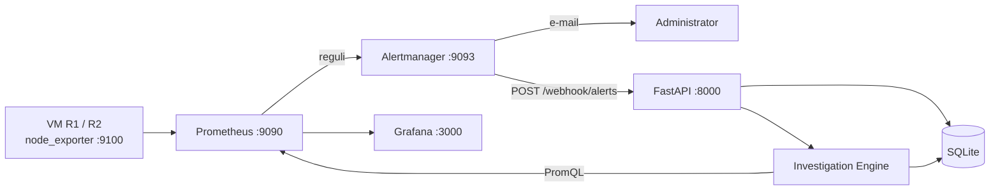

# NetOps Sentinel

Sistem de monitorizare pentru rețea. Prometheus detectează probleme pe două VM-uri (R1, R2), Alertmanager trimite alertele pe e-mail și către un API FastAPI, iar API-ul le salvează în SQLite și le transformă în incidente urmărite până la închidere. Pentru fiecare incident se poate porni o investigație care interoghează Prometheus și păstrează rezultatul ca dovadă.

## Arhitectură



## Infrastructură

### VM-uri și rețea

- **R1** și **R2** sunt două VM-uri care rulează `node_exporter` pe portul `9100`. Adresele lor sunt în rețeaua `192.168.122.0/24`: R1 = `192.168.122.247`, R2 = `192.168.122.195`.
- **Prometheus, Alertmanager și Grafana** rulează în containere Docker Compose (`monitoring/compose.yaml`), publicate doar pe `127.0.0.1`.
- **API-ul** rulează direct pe host, pe portul `8000`. Alertmanager, aflat într-un container, îl atinge prin gateway-ul rețelei Docker: `http://172.18.0.1:8000/webhook/alerts`.

| Serviciu | Port | Unde rulează |
|---|---|---|
| Prometheus | 9090 | container, doar 127.0.0.1 |
| Alertmanager | 9093 | container, doar 127.0.0.1 |
| Grafana | 3000 | container, doar 127.0.0.1 |
| Incident Manager (API) | 8000 | host |
| node_exporter | 9100 | pe fiecare VM |

### Prometheus

- Colectează metricile de la R1 și R2 la fiecare 15 secunde. Fiecare țintă are eticheta `router` (`R1` sau `R2`).
- Regulile de alertare (`prometheus/alerts.yml`):

| Alertă | Condiție | Durată |
|---|---|---|
| Țintă indisponibilă | `up == 0` | 2 minute |
| CPU ridicat | utilizare peste 90% | 5 minute |
| RAM ridicat | utilizare peste 85% | 5 minute |
| Disc plin | utilizare peste 85% | 10 minute |

### Alertmanager

- Grupează alertele și le trimite prin **două canale**: e-mail (Gmail SMTP) și webhook către API.
- Trimite și notificarea de rezolvare (`resolved`).
- Parola de aplicație Gmail se citește din fișierul secret `/run/secrets/gmail_app_password` și nu intră în Git.

### Grafana

Vizualizare pentru metricile din Prometheus (sursa de date). Nu participă la fluxul alertelor, e doar pentru citit grafice.

## Cum funcționează

1. **Detectare.** Prometheus evaluează regulile. Dacă o condiție ține destul de mult, alerta devine `firing`.
2. **Notificare.** Alertmanager trimite e-mail și `POST /webhook/alerts`. Cât alerta rămâne activă, o retrimite periodic, iar la final trimite `resolved`.
3. **Primire.** `receive_alerts` verifică fiecare alertă (câmpuri obligatorii, stare `firing` sau `resolved`) și află routerul din eticheta `router` sau din adresa `instance`. Alertele invalide sunt sărite, nu opresc restul.
4. **Salvare, într-o singură tranzacție** (`process_alert`):
   - episodul unei alerte e identificat prin perechea `fingerprint` + `started_at`;
   - alertă nouă → `created`; stare sau oră de încheiere schimbată → `updated`; repetiție identică → `duplicate` (nu se scrie nimic);
   - dacă e `created` și `firing`, se creează un incident `open` și se leagă de alertă.
5. **Incident.** Singura succesiune permisă: `open → investigating → resolved → closed`. La `closed` se completează `closed_at` (UTC). O alertă `resolved` nu închide automat incidentul.
6. **Investigație.** `POST /incidents/{id}/investigations` creează o investigație `running`. Engine-ul: află routerul incidentului, interoghează `up{router="..."}` în Prometheus, salvează rezultatul JSON ca dovadă, apoi marchează investigația `completed` sau `failed`.

## Structura proiectului

```
netops-sentinel/
├── incident_manager/
│   ├── main.py                        # API FastAPI
│   ├── database.py                    # SQLite: tranzacții și reguli
│   ├── models.py                      # gol (modelele sunt în main.py)
│   ├── data.sql                       # schema și interogări de dezvoltare
│   ├── data/incidents.db              # baza de date (ignorată de Git)
│   └── investigation/
│       ├── engine.py                  # orchestrarea unei investigații
│       └── collectors/
│           └── prometheus.py          # client Prometheus și verificarea `up`
└── monitoring/
    ├── compose.yaml                   # Prometheus, Alertmanager, Grafana
    ├── prometheus/
    │   ├── prometheus.yml             # ținte, etichete, conexiune la Alertmanager
    │   └── alerts.yml                 # regulile de alertare
    ├── alertmanager/alertmanager.yml  # rutare: e-mail și webhook
    └── secrets/                       # parole (ignorat de Git)
```

## Funcții

### `main.py`

| Funcție | Ce face |
|---|---|
| `receive_alerts(data)` | Validează webhook-ul, apelează `process_alert` pentru fiecare alertă și întoarce câte au fost create, actualizate, duplicate sau sărite. |
| `read_incident(incident_id)` | Returnează un incident ca JSON; 404 dacă nu există. |
| `update_status(incident_id, payload)` | Cere schimbarea stării și traduce erorile în 404 sau 409. |
| `create_investigation_incident(incident_id)` | Creează o investigație `running` (201); 404 dacă incidentul lipsește. |
| `IncidentStatusUpdate` | Schema Pydantic pentru corpul `{"status": "..."}`. |

### `database.py`

| Funcție | Ce face |
|---|---|
| `get_db_connection()` | Deschide conexiunea SQLite și activează cheile străine. |
| `get_incidents()` | Citește toate incidentele (încă neexpusă prin API). |
| `get_incident(id)` | Citește un incident după id. |
| `get_incident_router(id)` | Găsește routerul primei alerte legate de incident. |
| `save_alert(...)` | Inserează, actualizează sau ignoră o alertă; nu face commit. |
| `create_incident_for_alert(...)` | Creează incidentul `open` și legătura cu alerta; nu face commit. |
| `process_alert(...)` | Coordonează cele două de mai sus într-o tranzacție (un singur commit). |
| `update_incident_status(id, new_status)` | Validează tranziția, actualizează starea, setează `closed_at` la închidere. |
| `create_investigation(incident_id)` | Creează o investigație `running`; `None` dacă incidentul lipsește. |
| `save_evidence(...)` | Salvează o dovadă; rezultatul e serializat în JSON. |
| `finish_investigation(id, status)` | Trece o investigație din `running` în `completed` sau `failed` și setează `finished_at`. |

Regula de bază: funcțiile mici (`save_alert`, `create_incident_for_alert`) primesc conexiunea și nu fac commit. Cine deschide conexiunea (`process_alert`) decide când se salvează, ca totul să reușească sau să se anuleze împreună.

### `investigation/`

| Funcție | Ce face |
|---|---|
| `run_investigation(incident_id)` | Fluxul complet al unei investigații; întoarce un rezumat cu id-uri, router și rezultat. |
| `query_prometheus(promql)` | Trimite o interogare către API-ul Prometheus și întoarce lista de serii. |
| `collect_node_status(router)` | Verifică metrica `up` a routerului: `success` (1), `failed` (0) sau `error` (fără date). |

## API

| Metodă și rută | Scop |
|---|---|
| `POST /webhook/alerts` | Primește alertele de la Alertmanager. |
| `GET /incidents/{id}` | Citește un incident. |
| `PATCH /incidents/{id}/status` | Aplică următoarea tranziție validă. Coduri: 200, 404, 409, 422. |
| `POST /incidents/{id}/investigations` | Creează o investigație `running`. |

Documentația interactivă: `http://127.0.0.1:8000/docs`.

## Baza de date (SQLite)

- **`incidents`**: stare, severitate, `opened_at`, `closed_at`, cauză.
- **`alerts`**: `fingerprint`, nume, router, stare (`firing` sau `resolved`), `started_at`, `ended_at`.
- **`incident_alerts`**: legătura N:M dintre incidente și alerte (cheie primară compusă).
- **`investigations`**: incident, stare (`running`, `completed`, `failed`), `started_at`, `finished_at`.
- **`evidences`**: investigație, tip verificare, stare, rezultat (JSON ca text), `collected_at`.

## Pornire

Cerințe: Python 3.10+, Docker, `fastapi`, `uvicorn`, `requests`.

```bash
# monitorizare
cd monitoring
docker compose up -d

# API
cd ../incident_manager
python3 -m venv .venv && source .venv/bin/activate
pip install "fastapi[standard]" requests
uvicorn main:app --reload --host 0.0.0.0 --port 8000
```

Fișierul `data/incidents.db` trebuie să conțină deja tabelele; API-ul nu le creează singur.

## Status

**Funcționează:** monitorizarea și alertele, webhook-ul cu deduplicare, incidentele cu tranziții controlate, crearea unei investigații, colectorul `up`.

**Urmează:**
- conectarea endpoint-ului de investigație la `run_investigation()` (acum creează doar înregistrarea);
- inițializarea automată a schemei bazei de date și curățarea `data.sql`;
- endpoint-uri pentru lista de incidente și pentru citirea dovezilor;
- teste și un fișier de dependențe;
- autentificare pe API.