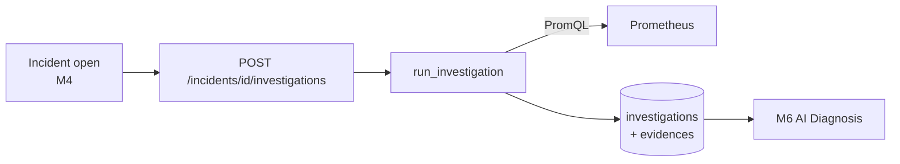

# NetOps Sentinel — M5: Investigation Engine

Când apare un incident, primul lucru pe care îl vrei este să știi **cum arată mașina acum**. Engine-ul face exact asta: întreabă Prometheus despre routerul afectat și păstrează răspunsurile ca **dovezi**.

## Ce face Engine-ul în proiect (și ce nu)

Este un **colector de fapte**, nu un judecător.

| Face | Nu face |
|---|---|
| Găsește routerul afectat de incident | Nu interpretează rezultatele și nu propune cauze |
| Verifică disponibilitatea, CPU, RAM, disc și rețeaua | Nu se conectează direct la VM-uri (totul trece prin Prometheus) |
| Salvează fiecare verificare ca dovadă în SQLite | Nu schimbă starea incidentului |

Interpretarea vine în M6: AI-ul citește exact dovezile pe care le salvează Engine-ul.

## Unde se leagă



- **De M4:** pornește de la un `incident_id`. Routerul se află prin legătura incident → alertă.
- **De API:** `POST /incidents/{id}/investigations` rulează Engine-ul chiar în cerere, deci răspunsul `201` conține rezumatul real.
- **De M6:** imediat după, API-ul pornește diagnosticul AI pe investigația nou creată.
## Cum e construit

| Fișier | Rol |
|---|---|
| `engine.py` | `run_investigation`: decide *ce* se verifică și în ce ordine |
| `collectors/prometheus.py` | `query_prometheus` + collectorii: doar măsoară, nu decid |
| `database.py` | Creează investigația, salvează dovezile, o închide |

Engine-ul decide, collectorii măsoară, `database.py` salvează. Adaugi un collector nou fără să schimbi restul.

## Orchestratorul: `run_investigation(incident_id)`

1. **Routerul.** `get_incident_router` îl găsește. Dacă nu există, întoarce `incident_router_not_found` și nu creează nimic.
2. **Investigația.** `create_investigation` o creează cu starea `running`.
3. **Disponibilitatea.** `collect_node_status` rulează **primul, mereu**, iar rezultatul se salvează ca dovadă.
4. **Metricile.** Dacă routerul e UP, rulează pe rând CPU, RAM, disc, interfețe și erori de rețea. Fiecare rezultat se salvează imediat.
5. **Închiderea.** `finish_investigation` o trece în `completed`.
6. **Rezumatul.** Întoarce `investigation_id`, `router`, `evidence_ids`, `evidence_count` și `skipped_collectors`.
**De ce metricile rulează doar dacă routerul e UP:** dacă ținta nu răspunde, interogările ar întoarce doar date goale. O singură dovadă clară (`prometheus_up = failed`) spune mai mult decât cinci erori.

| Situație | Dovezi salvate | Status investigație |
|---|---|---|
| Router UP | 6 (disponibilitate + 5 metrici) | `completed` |
| Router DOWN | 1 (`prometheus_up`, `failed`) | `completed` |
| Excepție în timpul rulării | cele salvate până atunci | `failed` |

Un router căzut **nu** înseamnă investigație eșuată: Engine-ul și-a făcut treaba, iar eșecul e chiar dovada. Dacă apare o excepție (de exemplu Prometheus oprit), investigația se marchează `failed`; nu rămâne blocată în `running`.

## Collectorii

Toate interogările trec prin `query_prometheus` (HTTP către Prometheus, timeout 5 secunde), deci timeout-ul și erorile sunt gestionate într-un singur loc. Fiecare collector întoarce aceeași formă:

```python
{"check_type": "cpu_usage", "status": "success", "result": {...}}
```

| Collector | Ce măsoară | Warning când |
|---|---|---|
| `collect_node_status` | Routerul răspunde la Prometheus | `up = 0` (status `failed`) |
| `collect_cpu_usage` | % CPU ocupat, media pe 5 minute | ≥ 90% |
| `collect_memory_usage` | % RAM ocupat | > 75% |
| `collect_disk_usage` | % ocupat pe `/` | > 85% |
| `collect_network_interfaces` | Interfețe sus/jos (fără `lo`) | orice interfață căzută |
| `collect_network_errors` | Erori RX/TX pe secundă, pe interfață, ultimele 5 minute (fără `lo`) | orice interfață cu erori |

Calculele sunt simple: CPU = cât timp **nu** a stat procesorul degeaba, RAM = `1 − disponibilă / totală`, disc = `1 − liber / total`.

Collectorii nu verifică dacă routerul e UP, pentru că Engine-ul îi apelează doar când este.

### Statusul unei dovezi

| Status | Înseamnă |
|---|---|
| `success` | Totul în regulă |
| `warning` | Datele există, dar o valoare e peste prag |
| `failed` | Ținta nu poate fi colectată (`up = 0`) |
| `error` | Prometheus nu a returnat date |

`up = 1` spune doar că ținta poate fi interogată, nu că rețeaua e sănătoasă. De asta urmează și verificările de metrici.

## Ce se salvează

- **`investigations`:** `incident_id`, `status` (`running` / `completed` / `failed`), `started_at`, `finished_at`.
- **`evidences`:** `investigation_id`, `check_type`, `status`, `result` (JSON text), `collected_at`.
Funcțiile din `database.py` implicate: `get_incident_router`, `create_investigation`, `save_evidence` (transformă `result` în JSON) și `finish_investigation` (acceptă doar trecerea din `running` în `completed` sau `failed`).
 