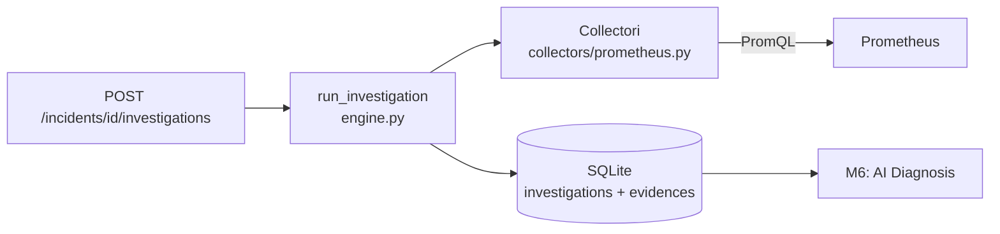

# NetOps Sentinel — M5: Investigation Engine

Partea care, pentru un incident deschis, **întreabă Prometheus ce se întâmplă cu routerul afectat și păstrează răspunsurile ca dovezi**.

**Ideea:** în loc să ghicim cauza din numele alertei, verificăm starea reală a mașinii și salvăm ce am găsit. Engine-ul nu interpretează nimic: doar colectează fapte. Interpretarea vine în M6 (AI).

| Etapă | Ce face | Stare |
|---|---|---|
| **M1–M3** Infrastructura | Monitorizare, alerte pe e-mail, grafice | Funcționează |
| **M4** Incident Manager | Primește alertele și gestionează incidentele | Funcționează |
| **M5** Investigation Engine | Investighează incidentele și salvează dovezile | **Acest document** |
| **M6** AI Diagnosis | Propune cauze și recomandări pe baza dovezilor | Funcționează |



## Cum se leagă de restul

- **De M4:** pornește de la un `incident_id`. Routerul se află prin legătura incident → alertă (`alerts.router`).
- **De Prometheus:** toate datele vin din interogări PromQL; Engine-ul nu se conectează la VM-uri.
- **De M6:** investigațiile `completed` și dovezile lor sunt singura sursă pe care AI-ul o poate citi.

## Structura

| Fișier | Rol |
|---|---|
| `engine.py` | `run_investigation`: orchestratorul, decide *ce* se verifică și în ce ordine |
| `collectors/prometheus.py` | `query_prometheus` + collectorii: doar *colectează*, nu decid |
| `database.py` | Funcțiile care citesc/scriu investigații și dovezi |

**Separarea rolurilor:** Engine-ul decide, Collectorii măsoară, `database.py` salvează. Un collector nou se adaugă fără a modifica restul.

## Orchestratorul (`engine.py`)

### `run_investigation(incident_id)`

Pe rând:

1. **Routerul:** `get_incident_router` găsește routerul afectat. Dacă nu există, întoarce `incident_router_not_found` și nu creează nimic.
2. **Investigația:** `create_investigation` o creează cu starea `running`. Dacă incidentul nu există, întoarce `incident_not_found`.
3. **Disponibilitatea:** `collect_node_status` rulează **primul, mereu**, iar rezultatul se salvează ca dovadă.
4. **Metricile:** dacă routerul e `success` (UP), rulează pe rând `collect_cpu_usage`, `collect_memory_usage`, `collect_disk_usage`, `collect_network_interfaces`, `collect_network_errors`. Fiecare rezultat se salvează imediat.
5. **Închiderea:** `finish_investigation(..., "completed")`.
6. **Rezumatul:** întoarce `investigation_id`, `router`, `evidence_ids`, `evidence_count` și `skipped_collectors`.

**De ce metricile rulează doar dacă routerul e UP:** dacă ținta nu răspunde, interogările de metrici ar întoarce date goale și ar produce doar erori fără sens. O singură dovadă clară (`prometheus_up = failed`) spune mai mult.

### Rezultat

| Situație | Dovezi salvate | `skipped_collectors` | Status investigație |
|---|---|---|---|
| Router UP | 6 (node status + 5 metrici) | gol | `completed` |
| Router DOWN | 1 (`prometheus_up`, `failed`) | cei 5 collectori | `completed` |
| Excepție în timpul rulării | cele salvate până atunci | — | `failed` |

Routerul căzut **nu** înseamnă investigație eșuată: Engine-ul și-a făcut treaba, iar eșecul este chiar dovada. Dacă apare o excepție (de exemplu Prometheus oprit), investigația este marcată `failed` și excepția este aruncată mai departe; nu rămâne blocată în `running`.

## Funcțiile din `database.py`

| Funcție | Ce face |
|---|---|
| `get_incident_router` | Găsește routerul afectat (R1, R2 sau nimic) prin incident → alertă |
| `create_investigation` | Verifică dacă incidentul există și creează investigația `running` |
| `save_evidence` | Salvează o dovadă; `result` este transformat în JSON text |
| `finish_investigation` | Trece investigația din `running` în `completed` sau `failed` și notează ora |

## Collectorii (`collectors/prometheus.py`)

### `query_prometheus(promql)`

Trimite interogarea la `http://localhost:9090/api/v1/query` (timeout 5 secunde) și întoarce lista de rezultate. Aruncă excepție dacă HTTP-ul eșuează sau dacă Prometheus nu răspunde cu `status: success`. **Orice collector trece prin ea**, deci timeout-ul și gestionarea erorilor sunt într-un singur loc.

### Forma comună

Fiecare collector întoarce un dicționar cu aceleași trei câmpuri, deci Engine-ul le tratează la fel:

```python
{"check_type": "cpu_usage", "status": "success", "result": {...}}
```

### Cei 6 collectori

| Collector | `check_type` | Ce măsoară | Prag | Warning când |
|---|---|---|---|---|
| `collect_node_status` | `prometheus_up` | Routerul răspunde (`up`) | — | `up = 0` → `failed` |
| `collect_cpu_usage` | `cpu_usage` | % CPU ocupat, media pe 5 minute | 90% | `≥ 90` |
| `collect_memory_usage` | `memory_usage` | % RAM ocupat, valoare curentă | 75% | `> 75` |
| `collect_disk_usage` | `disk_usage` | % ocupat pe `/` | 85% | `> 85` |
| `collect_network_interfaces` | `network_interfaces` | Interfețe sus/jos (fără `lo`) | — | orice interfață cu `up = 0` |
| `collect_network_errors` | `network_errors` | Erori RX/TX pe secundă, pe interfață, ultimele 5 min (fără `lo`) | — | orice interfață cu erori > 0 |

Cum se calculează:

- **CPU:** `100 × (1 − media timpului idle)`, deci cât timp **nu** a stat procesorul degeaba.
- **RAM:** `100 × (1 − MemAvailable / MemTotal)`; folosește memoria *disponibilă*, nu doar „liberă".
- **Disc:** `100 × (1 − spațiu disponibil / total)` pe `mountpoint="/"`.
- **Interfețe și erori:** rezultatul conține o listă cu câte o intrare pe interfață și statusul ei; statusul general este `warning` dacă măcar una are probleme.

### Statusul unei dovezi

| Status | Înseamnă |
|---|---|
| `success` | Totul în regulă |
| `warning` | Datele există, dar o valoare e peste prag |
| `failed` | Ținta nu poate fi colectată (`up = 0`) |
| `error` | Prometheus nu a returnat date pentru interogare |

`up = 1` înseamnă doar că ținta poate fi interogată, nu că rețeaua e sănătoasă. De asta urmează verificările de metrici.

**Collectorii nu verifică dacă routerul e UP**, pentru că Engine-ul îi apelează doar când este.

## Ce se salvează

În SQLite, în două tabele:

- `investigations`: `incident_id`, `status` (`running` / `completed` / `failed`), `started_at`, `finished_at`.
- `evidences`: `investigation_id`, `check_type`, `status`, `result` (JSON text), `collected_at`.

## Ce urmează

1. Endpoint pentru lista de investigații și dovezi.
2. Teste cu Prometheus simulat (mock) pentru fiecare collector și pentru cazurile UP / DOWN / excepție.
3. Colectori noi (de exemplu trafic de rețea, load average), adăugați în lista de collectori.
