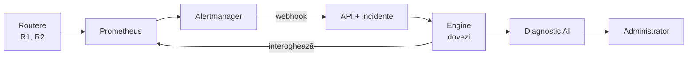
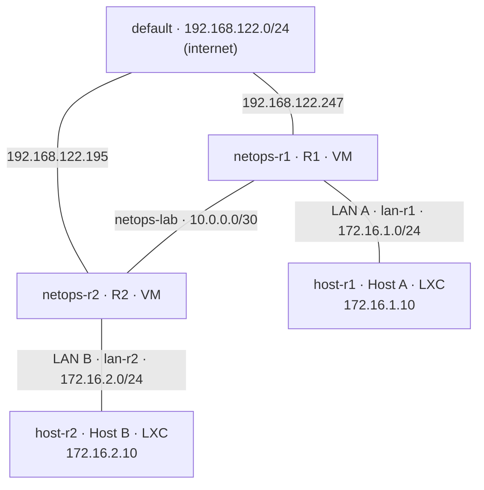

# NetOps Sentinel

Un laborator de rețea făcut de la zero, care **observă singur când ceva se strică** și ne spune ce s-a întâmplat probabil.

Am construit mașinile și rețeaua, le-am pus sub monitorizare, iar deasupra am făcut o aplicație care primește o alertă, o transformă într-un incident, strânge dovezi și cere unui model AI o părere. Toate cele șase milestone-uri sunt terminate.

## Cum funcționează, pe scurt

Să zicem că routerul R1 se oprește. Iată ce se întâmplă:

1. **Prometheus** vede că nu mai primește nimic de la R1 și ridică o alertă.
2. **Alertmanager** o trimite aplicației noastre printr-un webhook.
3. Aplicația o salvează și **deschide un incident**.
4. Noi pornim o **investigație**: aplicația întreabă Prometheus cum stă routerul (e pornit? cât CPU, RAM și disc folosește? cum e rețeaua?) și păstrează răspunsurile ca **dovezi**.
5. Un **model AI** citește dovezile și scrie ce crede că s-a întâmplat și ce ar merita verificat.
6. Noi citim diagnosticul și **hotărâm ce facem**. AI-ul doar dă o părere, nu schimbă nimic în sistem.



## Infrastructura

Laboratorul are **două routere** (VM-uri Ubuntu Server) și **două calculatoare** (containere LXC), legate prin trei rețele virtuale libvirt:

- `default` are acces la internet;
- `netops-lab` este legătura directă dintre cele două routere;
- `lan-r1` și `lan-r2` sunt cele două LAN-uri, câte unul pentru fiecare router.



| Mașină | Adrese | Rol |
|---|---|---|
| `netops-r1` | `enp1s0` 192.168.122.247, `enp7s0` 10.0.0.1/30, `enp8s0` 172.16.1.1/24 | Routerul LAN-ului A; știe că `172.16.2.0/24` se ajunge prin `10.0.0.2` |
| `netops-r2` | `enp1s0` 192.168.122.195, `enp7s0` 10.0.0.2/30, `enp8s0` 172.16.2.1/24 | Routerul LAN-ului B; știe că `172.16.1.0/24` se ajunge prin `10.0.0.1` |
| `host-r1` | `eth0` 172.16.1.10/24, gateway 172.16.1.1, DNS 8.8.8.8 | Calculatorul din LAN A |
| `host-r2` | `eth0` 172.16.2.10/24, gateway 172.16.2.1, DNS 8.8.8.8 | Calculatorul din LAN B |

Ambele routere au `ip_forward=1`, ca să paseze pachetele mai departe, și `MASQUERADE` pe `enp1s0`, ca hosturile să poată ieși pe internet cu adresa routerului.

**Ce se întâmplă când `host-r1` vorbește cu `host-r2`?** Pachetul pleacă spre gateway, adică R1. R1 are o rută statică spre `172.16.2.0/24` prin `10.0.0.2`, deci îl trimite lui R2, iar R2 îl predă direct în LAN B.

O mică atenție: adresele `192.168.122.x` vin prin DHCP și se pot schimba, restul sunt statice. Dacă se schimbă, trebuie actualizat dicționarul `ROUTERS` din `main.py`, altfel aplicația nu mai știe care alertă aparține cărui router.

## Drumul proiectului

**M1 — Infrastructura virtuală.** Am montat laboratorul cu Ubuntu, KVM, QEMU, libvirt și virt-manager: mașini Ubuntu Server cu rețele separate pentru management și laborator.

**M2 — Network Engineering.** Am construit LAN-urile, am configurat routerele, am făcut rutare statică, am analizat pachete și am lucrat cu protocoale dinamice. Acum înțelegem și controlăm drumul pachetelor.

**M3 — Observability & Monitoring.** Am pus Docker, Prometheus, Grafana și exporter-e care colectează informații din rețea. Avem dashboard-uri și alerte pentru latency, packet loss, disponibilitatea dispozitivelor și starea rutării.

**M4 — Incidente și API.** Aplicația primește alertele, le salvează în SQLite și urmărește fiecare incident de la deschidere până la închidere (`open → investigating → resolved → closed`).

**M5 — Investigation Engine.** Când pornim o investigație, Engine-ul întreabă Prometheus despre routerul afectat și salvează răspunsurile ca dovezi. Doar adună fapte, nu trage concluzii.

**M6 — AI Diagnosis.** Un model AI citește dovezile (doar în citire, prin tool-uri) și propune o cauză probabilă, cu recomandări sigure.

## Din ce e făcut

- **Laborator:** Ubuntu Server, KVM, QEMU, libvirt, virt-manager, LXC
- **Monitorizare:** Docker, Prometheus, Alertmanager, Grafana, node_exporter
- **Aplicație:** Python, FastAPI, SQLite
- **AI:** un model NVIDIA (API compatibil OpenAI) și MCP pentru tool-uri

## Cum arată codul

```
incident_manager/
├── main.py            # API-ul (FastAPI)
├── database.py        # tot SQL-ul
├── investigation/     # Engine-ul M5 (orchestrator + collectori Prometheus)
├── AI_part/           # M6: agent, server MCP, interogări read-only
└── data/incidents.db  # baza SQLite
```

## Cum îl pornești

```bash
export NVIDIA_API_KEY="cheia-ta"
uvicorn incident_manager.main:app
```

Alertmanager trimite alertele la `POST /webhook/alerts`, iar dashboard-urile le vezi în Grafana.

## Vrei mai multe detalii?

Aici e doar imaginea de ansamblu. Fiecare parte mare are propriul README:

- **M4, baza de date și API:** [`README_database_api.md`](README_database_api.md)
- **M5, Investigation Engine:** [`README_engine.md`](README_engine.md)
- **M6, AI Diagnosis:** [`README_ai_diagnosis.md`](README_ai_diagnosis.md)
