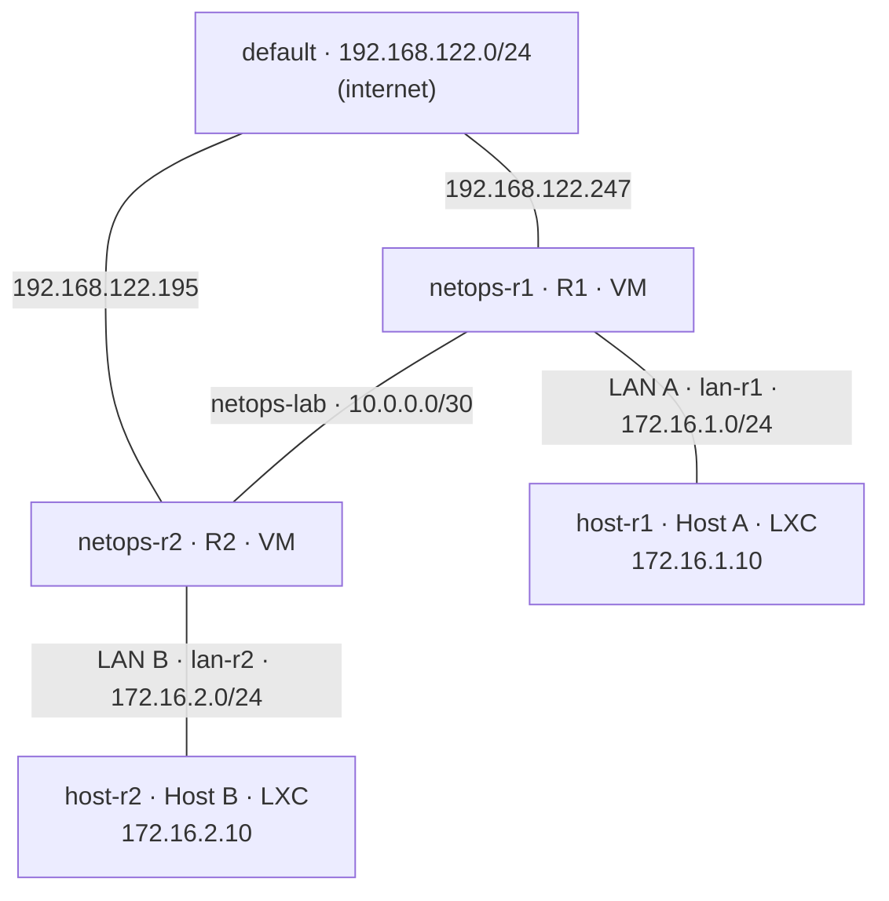

<p align="center">
  
</p>

**Simulator UI:** [netopssentinel.duckdns.org](https://netopssentinel.duckdns.org/) is the HTTP version of the interface, running as a simulator. The live version, connected to the real lab, is coming next.

---

A network lab built from scratch that **notices when something breaks** and tells you what probably happened. Two routers and two hosts sit under monitoring, and an app on top turns every alert into an incident, gathers evidence and asks an AI model for an opinion. All six milestones are done.

## How it works

When a router goes down, **Prometheus** raises an alert and **Alertmanager** forwards it to the API. The API opens an **incident**, the **engine** collects evidence from Prometheus (status, CPU, RAM, disk, network) and an **AI model** reads it and suggests a likely cause.

The AI is read-only. It gives an opinion and changes nothing in the system: **you decide.**

## Stack

| Layer | Tools |
| --- | --- |
| Lab | Ubuntu Server, KVM, QEMU, libvirt, virt-manager, LXC |
| Monitoring | Docker, Prometheus, Alertmanager, Grafana, node_exporter |
| App | Python, FastAPI, SQLite |
| AI | An NVIDIA model (OpenAI-compatible API) and MCP tools |

## Go deeper

Each part of the backend has its own README.

<table>
<tr>
<td width="38%" valign="top">
<sub>Milestone 4</sub><br>
<b><a href="incident_manager/README.md">Incidents and API</a></b><br>
<code>incident_manager/README.md</code>
</td>
<td valign="top">How alerts arrive through the webhook, get stored in SQLite and move from <code>open</code> to <code>closed</code>.</td>
</tr>
<tr>
<td width="38%" valign="top">
<sub>Milestone 5</sub><br>
<b><a href="incident_manager/investigation/investigation_README.md">Investigation Engine</a></b><br>
<code>investigation/investigation_README.md</code>
</td>
<td valign="top">How the engine queries Prometheus about the affected router and saves the answers as evidence. It gathers facts and draws no conclusions.</td>
</tr>
<tr>
<td width="38%" valign="top">
<sub>Milestone 6</sub><br>
<b><a href="incident_manager/AI_part/ai_README.md">AI Diagnosis</a></b><br>
<code>AI_part/ai_README.md</code>
</td>
<td valign="top">How a model reads the evidence through read-only tools and proposes a probable cause with safe recommendations.</td>
</tr>
</table>

## Run it

```bash
export NVIDIA_API_KEY="your-key"
uvicorn incident_manager.main:app
```

Alertmanager posts alerts to `POST /webhook/alerts`, and the dashboards live in Grafana.

---

<details>
<summary><b>Milestones</b></summary>

<br>

- **M1, Virtual infrastructure:** Ubuntu Server machines on KVM, QEMU and libvirt, with separate management and lab networks.
- **M2, Network engineering:** LANs, router configuration, static routing, packet analysis and dynamic protocols.
- **M3, Observability:** Docker, Prometheus, Grafana and exporters, with dashboards and alerts for latency, packet loss, device availability and routing state.
- **M4, Incidents and API:** alerts are received, saved in SQLite and tracked through `open → investigating → resolved → closed`.
- **M5, Investigation Engine:** queries Prometheus about the affected router and stores the answers as evidence.
- **M6, AI Diagnosis:** a model reads the evidence (read-only, through tools) and proposes a probable cause with safe recommendations.

</details>

<details>
<summary><b>Lab network</b></summary>

<br>

Two routers (Ubuntu Server VMs) and two hosts (LXC containers), connected through three libvirt virtual networks:

- `default` has internet access;
- `netops-lab` is the direct link between the two routers;
- `lan-r1` and `lan-r2` are the two LANs, one per router.



| Machine | Addresses | Role |
| --- | --- | --- |
| `netops-r1` | `enp1s0` 192.168.122.247, `enp7s0` 10.0.0.1/30, `enp8s0` 172.16.1.1/24 | Router of LAN A; reaches `172.16.2.0/24` through `10.0.0.2` |
| `netops-r2` | `enp1s0` 192.168.122.195, `enp7s0` 10.0.0.2/30, `enp8s0` 172.16.2.1/24 | Router of LAN B; reaches `172.16.1.0/24` through `10.0.0.1` |
| `host-r1` | `eth0` 172.16.1.10/24, gateway 172.16.1.1, DNS 8.8.8.8 | Computer in LAN A |
| `host-r2` | `eth0` 172.16.2.10/24, gateway 172.16.2.1, DNS 8.8.8.8 | Computer in LAN B |

Both routers have `ip_forward=1` to pass packets along, and `MASQUERADE` on `enp1s0` so the hosts can reach the internet through the router's address.

When `host-r1` talks to `host-r2`, the packet goes to its gateway, R1. R1 has a static route to `172.16.2.0/24` through `10.0.0.2`, so it hands the packet to R2, which delivers it straight into LAN B.

The `192.168.122.x` addresses come from DHCP and can change; everything else is static. If they change, update the `ROUTERS` dictionary in `main.py`, otherwise the app can no longer tell which alert belongs to which router.

</details>

<details>
<summary><b>Code layout</b></summary>

<br>

```
incident_manager/
├── main.py            # the API (FastAPI)
├── database.py        # all the SQL
├── investigation/     # M5 engine (orchestrator + Prometheus collectors)
├── AI_part/           # M6: agent, MCP server, read-only queries
└── data/incidents.db  # SQLite database
```

</details>
